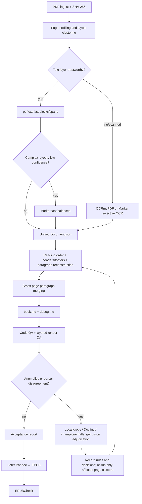

# Dynamic PDF → Markdown Extraction: Research, Sample Measurements, and Implementation Plan

Research and measurement date: 2026-07-21

## 1. Goals and Boundaries

The goal is to handle PDFs that differ every time, without relying on fixed templates:

- Restore correct reading order, word/character spacing, paragraphs, headings, lists, tables, and image references.
- Merge paragraphs split across page boundaries while retaining traceable original page numbers and coordinates.
- Remove genuine running headers, footers, and page numbers, while treating accidental body-text deletion as the highest-priority defect.
- Emit simple, stable Markdown first; generate EPUB, DOCX, and other formats later from the same intermediate structure.
- Calibrate iteratively through layered page renders and structured visual review; only route anomalous pages/regions into the expensive path.
- Anything determinable from PDF objects, fonts, colors, coordinates, vector lines, and statistical rules is code-first; models handle only rule-level uncertainty.
- For every new PDF, produce a coherent pilot slice with explicit page, word, image, and vision-call budgets; expand to the full book only after human review passes.
- Position the project as a meta-tool that helps an AI agent generate and calibrate PDF parsing workflows, with a clear separation between the reusable engine and one-off document adaptation.
- Manage Python exclusively through `uv` with a lockfile, keeping experiments and production reproducible.

No promise of unconditional fully-automatic success on arbitrary PDFs. The system must emit confidence, decision logs, and review items; at low confidence it prefers keeping a suspect page break or header over silently deleting body text.

## 2. Conclusions First

Recommend a "router + layered parsing + unified intermediate representation + local visual calibration" architecture rather than betting on a single PDF library:

1. `pdftext` for a fast text-layer and bbox first pass on born-digital PDFs.
2. Marker as the primary structural parser for complex layouts; prefer `fast/no-OCR`, escalating to balanced/selective OCR only when needed.
3. Docling for shadow parsing/fallback only at low confidence, complex tables, or parser disagreement.
4. OCRmyPDF only for purely scanned, rotated, skewed, or corrupt-OCR-layer documents; never re-OCR a normal text-layer PDF wholesale.
5. `pdfplumber` for diagnostics, coordinate verification, gold-standard test support, and visual debugging — not the production first pass.
6. Vision models do not re-transcribe whole books; they adjudicate reading order, paragraph boundaries, headers/footers, figure regions, and other hard cases, returning structured issue/decision output.
7. Vision providers run champion/challenger: all candidates compete on the benchmark set, production defaults to a single first-pass model, and a second/third model is escalated only on disagreement or high risk.
8. Every book starts with a "TOC + first chapter" pilot slice (or a coverage equivalent); full-book processing is unlocked only after human confirmation.

Markdown is a derived reading artifact; the true lossless working document is `document.json`. Once Markdown has discarded page numbers, bboxes, raw blocks, and confidence, reliable back-tracing and repair become very hard.

## 3. GitHub Survey Results

| Project | Reusable capabilities | Role | Key caveats |
|---|---|---|---|
| [datalab-to/pdftext](https://github.com/datalab-to/pdftext) | PDFium-based page/block/line/span, fonts, bboxes; Apache-2.0 | Fast native text-layer first pass | No complete semantic structure, cross-page paragraphs, or vision loop |
| [datalab-to/marker](https://github.com/datalab-to/marker) | Markdown/JSON, layout/reading order, tables/formulas/images, default header/footer removal, debug page renders with bboxes, optional LLM | Primary complex-layout parser | Modes and hardware requirements vary widely; its own benchmark is reference only and must be re-measured on local samples |
| [docling-project/docling](https://github.com/docling-project/docling) | Advanced layout, reading order, tables, OCR, unified DoclingDocument, Markdown and lossless JSON; MIT | Shadow parser/fallback | Heavy dependencies and models; no need to double-run every page |
| [jsvine/pdfplumber](https://github.com/jsvine/pdfplumber) | char/word bboxes, font attributes, cropping, text/table debugging | Diagnostics and testing | Clearly slower than `pdftext` on the local sample; parts of its line API remain experimental |
| [pymupdf/pymupdf4llm](https://github.com/pymupdf/pymupdf4llm) | Markdown/JSON, reading order, tables, selective OCR, page chunks | Technology comparison candidate | AGPL-3.0; a licensing decision is required before closed-source/commercial use, so it is not a default dependency |
| [ocrmypdf/OCRmyPDF](https://github.com/ocrmypdf/OCRmyPDF) | Adds searchable text layers to scanned PDFs, rotation/deskew, multilingual OCR | Scanned-input preprocessing | Needs system dependencies such as Tesseract; produces an OCR layer, not paragraph/reading-order reconstruction |
| [Layout-Parser/layout-parser](https://github.com/Layout-Parser/layout-parser) | Layout detection, region cropping, bbox visualization | Region-extraction API reference | Not the primary skeleton; maintenance cadence and the Detectron2 dependency fit less well than the options above |
| [Unstructured-IO/unstructured](https://github.com/Unstructured-IO/unstructured) | Document partitioning, ETL, fast/hi-res/OCR routing ideas | Architecture reference | Abstraction level is high for this task; custom cross-page paragraphs and render-review loops are easier with direct control of the lower layers |

Marker explicitly supports removing running headers/footers by default and saving page renders with detection results and JSON in debug mode; Docling offers a unified document structure and lossless JSON. Both align well with this task, but neither replaces our own cross-page merging, confidence tracking, or iterative controller.

## 4. Measurements on the Current Sample

Sample: `inputs/Breaking Comedy's DNA_v1.4.4-[US]Jerry Corley.pdf`

### 4.1 Document baseline

- 221 pages, Letter 612 × 792 pt, about 3.44 MB.
- 221/221 pages have a native text layer; this sample should not default to OCR.
- `pdfplumber` probe: 275,932 characters, 48,499 words; non-empty page medians of about 1,291 characters / 226 words.
- 55 pages contain embedded images.
- Multiple body pages resume text very near the top of the page. A fixed crop of the top 10–15% would delete body text.

### 4.2 Local extraction speed

Both tests ran through `uv run --with ...`; first-run package downloads are excluded from the script-reported extraction times.

| Path | Work | Time | Throughput |
|---|---|---:|---:|
| `pdftext.dictionary_output(sort=True)` | 221 pages, 1,673 blocks, 276,989 span chars | 6.586 s | 33.56 pages/s |
| `pdfplumber.extract_text(...)` | 221 pages, 273,402 chars | 23.390 s | 9.45 pages/s |

On this sample and machine, `pdftext` throughput is about 3.55× `pdfplumber`, and it yields block/line/span structure directly. That supports making it the fast first pass. The number is not a universal conclusion across machines or PDFs; the benchmark set must keep re-measuring.

### 4.3 A cross-page paragraph instance

End of page 37:

> that drives you crazy, and make it funny!” If you think something’s

Start of page 38:

> weird or ridiculous or stupid or crazy or misplaced or ironic, that’s kind

This is an unambiguous same-paragraph continuation across pages and should merge into one paragraph with source pages `37–38` recorded.

Scanning the whole book with only "previous page does not end in terminal punctuation + next page starts lowercase" yields 29 candidates, of which the TOC boundary 3→4 is a confirmed false positive. Punctuation rules are therefore good candidate generators, but automatic merging must also weigh block type, TOC/section state, fonts, indentation, column position, and visual spacing.

### 4.4 Render resolution, readability, and token cost proxies

Page 38 (dense body text) was rendered at 72–300 DPI and scored with local RapidOCR against the native text as reference. OpenAI's current image documentation: `low` receives a 512×512 low-resolution image; GPT-5.6 `original/auto` preserves input size, and patch-based image cost is computed per 32×32 patch. See [OpenAI Images and vision](https://developers.openai.com/api/docs/guides/images-vision).

The "patch units" below are GPT-5.6 `original/auto` image-cost proxies computed from pixel sizes with the official formula; actual billing follows the usage returned by the specific model/API.

| DPI | Pixels | Patch units | Relative to 96 DPI | RapidOCR word F1 |
|---:|---:|---:|---:|---:|
| 72 | 612×792 | 500 | 0.58× | 0.994 |
| 96 | 816×1056 | 858 | 1.00× | 0.921 |
| 120 | 1020×1320 | 1,344 | 1.57× | 0.873 |
| 144 | 1224×1584 | 1,950 | 2.27× | 0.942 |
| 168 | 1428×1848 | 2,610 | 3.04× | 0.804 |
| 180 | 1530×1980 | 2,976 | 3.47× | 0.844 |
| 216 | 1836×2376 | 4,350 | 5.07× | 0.915 |
| 300 | 2550×3300 | 8,320 | 9.70× | 0.828 |

Observations:

- OCR scores do not rise monotonically with DPI, due to detector-internal scaling and line-merging behavior. "Higher DPI is always more accurate" is therefore not a valid policy.
- 72 DPI is readable on this clean body page and scored best with local OCR, but the font is small for humans and vision models.
- 96 DPI was manually checked on a TOC-dense page, a text/image page, a sparse-heading page, and a long-text page; all were clearly readable. It saves about 36% patches versus 120 DPI and about 56% versus 144 DPI.
- 300 DPI costs about 9.7× more than 96 DPI yet scored worse on this OCR proxy test; it should not be the default for full pages.

Recommendations:

- 72 DPI: layout overview only — whitespace, column count, image regions.
- 96 DPI: default full-page text QA, explicitly using `detail="original"` so we control the input size.
- 144 DPI: escalation for the smallest fonts, dense TOCs, footnotes, or low 96 DPI confidence.
- 180–216 DPI: only for local crops of table cells, formulas, or footnotes; never full pages.
- 300 DPI: reserved for special local-OCR cases; disabled by default for full-page vision API calls.

RapidOCR is only a readability proxy. The production implementation must record each vision call's actual `input_tokens`, model, detail setting, dimensions, and crop area in the usage log to obtain the real cost curve.

### 4.5 Gemini and multi-provider price comparison at the time of writing

Conclusion: Gemini can be substantially cheaper, but "Gemini" is not a single price tier.

- [Gemini 3.1 Flash-Lite](https://ai.google.dev/gemini-api/docs/models/gemini-3.1-flash-lite) is the current stable low-price model suited to frequent lightweight structural judgments, at an official $0.25/MTok input and $1.50/MTok output.
- [Gemini 2.5 Flash-Lite](https://ai.google.dev/gemini-api/docs/models/gemini-2.5-flash-lite) is cheaper still, at $0.10/MTok input and $0.40/MTok output, worth including in a cheap-screening benchmark; whether it reliably identifies small fonts, cross-column text, and fine-grained formatting must be decided by the gold set.
- Gemini 3.5 Flash is $1.50/MTok input and $9/MTok output; it is not necessarily cheaper than OpenAI GPT-5.6 Luna.
- OpenAI's current GPT-5.6 Luna is $1/MTok input and $6/MTok output; Terra is $2.50/$15. See [OpenAI models](https://developers.openai.com/api/docs/models).
- Claude Haiku 4.5 is $1/MTok input and $5/MTok output, with images metered in 28×28 patches; see [Claude models](https://platform.claude.com/docs/en/about-claude/models/overview) and [Claude vision](https://platform.claude.com/docs/en/build-with-claude/vision).

Gemini 3 offers `media_resolution` to control the per-image/PDF-page vision budget: low/medium/high for image/PDF correspond roughly to 280/560/1,120 tokens; Google recommends medium for standard PDF understanding and notes that raising standard documents from medium to high rarely improves OCR further. See [Gemini media resolution](https://ai.google.dev/gemini-api/docs/media-resolution) and [Gemini pricing](https://ai.google.dev/gemini-api/docs/pricing).

Using this 96 DPI page with a 200-JSON-text-token response, and ignoring prompt text, caching, reasoning tokens, retries, and discounts, rough list prices:

| Model/setting | Est. image input tokens | Approx. image input cost | Approx. 200-output-token cost | Approx. total/page |
|---|---:|---:|---:|---:|
| Gemini 2.5 Flash-Lite medium | 256 | $0.000026 | $0.000080 | $0.000106 |
| Gemini 3.1 Flash-Lite medium | 560 | $0.000140 | $0.000300 | $0.000440 |
| OpenAI GPT-5.6 Luna original | 858 | $0.000858 | $0.001200 | $0.002058 |
| Claude Haiku 4.5 | 1,140 | $0.001140 | $0.001000 | $0.002140 |
| Gemini 3.5 Flash medium | 560 | $0.000840 | $0.001800 | $0.002640 |
| OpenAI GPT-5.6 Terra original | 858 | $0.002145 | $0.003000 | $0.005145 |

This is pricing-model arithmetic, not a quality ranking. The formal choice must measure `issue precision/recall × cost × latency`, and cap output to short JSON — for visual QA, output tokens are often more expensive than image inputs.

## 5. Automation Architecture



### 5.1 Page profiling and dynamic routing

Computed per page before any vision call:

- Text character count, non-printable/replacement-character rate, font count, minimum font size.
- Page size/rotation, image-area ratio, vector density, text bbox coverage.
- Line-width distribution, x-start clusters, suspected column count, reading-order jumps.
- OCR-layer duplication, hidden text, duplicate characters at identical coordinates.
- Layout-signature similarity with neighboring pages.

Pages cluster into section/layout clusters by layout signature. Header/footer and paragraph parameters are learned within page clusters, not imposed as one fixed book-wide threshold set.

### 5.2 Unified intermediate representation

Recommended output:

```text
artifacts/<run-id>/
  document.json          # lossless, with bbox/style/provenance/confidence
  book.md                # clean reading Markdown
  book.debug.md          # optional, with hidden provenance/issue markers
  assets/                # extracted images
  qa/manifest.jsonl      # renders, crops, DPI, patches/tokens, issues, adjudications
  qa/screenshots/
  report.json            # metrics, failures, versions, timings
```

A `document.json` block carries at minimum:

- `id`, `type`, `text`, `page`, `bbox_norm`, `reading_order`
- `font_family`, `font_size`, `weight`, `italic`, `underline`, `fill_rgb`, `stroke_rgb`, `style_runs`
- `source_parser`, `source_block_id`, `confidence`
- `removed_as`, `merge_from`, `merge_reasons`, `decision_version`

The reading copy `book.md` shows no visible page numbers and no complex CSS. Provenance stays in the JSON; the debug version may use HTML comments such as `src:p37-p38`, avoiding EPUB pollution.

### 5.3 Tokenization and text normalization

Keep two concepts separate:

1. **Visual word/space reconstruction**: driven by character/word bboxes, fonts, and spacing; directly determines readable Markdown text.
2. **NLP tokenization**: only for retrieval, similarity, language detection, and QA; stored in a sidecar index. It must never inject spaces backward into body text.

Normalization order: Unicode NFKC (with justified exceptions preserving meaningful original glyphs) → ligature expansion → duplicate-glyph deduplication → in-line space decisions → cross-line word-break/hyphen decisions → paragraph reconstruction. The original text and every transformation step must remain traceable.

### 5.4 Code-first section and inline-style recognition

Before any model call, compute candidates and confidence from native PDF objects:

- **TOC**: dot leaders, right-aligned page numbers, repeated indentation levels, short-line density, internal link/bookmark targets, contiguous page ranges.
- **Titles/headings**: z-score of font size relative to the body mode, weight/color, page position, surrounding whitespace, short lines, numbering patterns, bookmarks/outline, and the stable transition to following body text.
- **Body text**: dominant font/size/line height within the page cluster, stable left/right boundaries, normal syntactic lengths, continuous paragraph flow.
- **Headers/footers**: cross-page repetition within the cluster, stable y coordinates, odd/even patterns, and page-number sequences; fixed-margin cropping is forbidden.
- **Bold**: font weight/name/flags; also detect faux bold from "duplicate drawing at identical or slightly offset coordinates" and deduplicate it first.
- **Italic**: italic font/flags, font names, and where necessary glyph transform/shear.
- **Underline**: never from fonts alone; match thin horizontal lines/rects below the text baseline with overlapping x ranges, distinguishing table rules, strikethrough, and link decoration.
- **Semantic color**: read text fill/stroke RGB; apply color clustering and contrast thresholds. Never guess color from screenshot pixels.

Standard Markdown mapping: bold `**text**`, italic `*text*`. Underline and semantic color use minimal inline HTML such as `<u>` or `<span class="text-red">`; exact RGB and source spans stay in `document.json`. Decorative color is excluded from the reading copy by default; semantic color is preserved.

Code rules emit `type/style + confidence + evidence`. Only conflicting features, corrupt font metadata, visually simulated formatting, or parser disagreement enter the visual queue.

### 5.5 Headers, footers, and page numbers

Candidate features:

- Located in the cluster's top/bottom bands, but "in a band" alone never triggers deletion.
- Text repeats across the cluster after digit normalization; alternating odd/even headers are allowed.
- Stable y position and font, low overlap with body text.
- Page numbers match monotonic sequences, Roman numerals, or "Page x of y" patterns.
- Covers, TOCs, and chapter openings are handled separately and excluded from normal repetition statistics.

Deletion policy: at least two independent pieces of evidence plus a tombstone record. Low confidence is only annotated in `book.debug.md`, never auto-deleted. Acceptance metrics prioritize precision, targeting zero accidental body deletions.

### 5.6 Paragraph and cross-page merging

In-page merging uses: line spacing relative to the median, first-line/hanging indents, left/right boundaries, font styles, bullets, column membership, punctuation, and semantic continuity.

Cross-page merging requires all of:

- The last block of the previous page and the first block of the next page are both paragraphs, not crossing section/list/table/image boundaries.
- Compatible column position, font, size, line width, and indentation.
- The previous page's last sentence lacks terminal punctuation or ends in a soft hyphen; next page starting lowercase/continuation punctuation is a bonus signal, not a standalone decision.
- The next page's first block is not a running header, heading, TOC entry, or caption.
- Merged coherence improves under language-model/rule checks without abnormal spacing.

High confidence merges automatically; medium confidence keeps the break and enters the local render queue; low confidence does not merge. Precision beats recall — a wrong merge is harder to notice than a temporary extra paragraph boundary.

## 6. Render-Driven Dynamic Debugging Loop

The render loop runs after code QA. TOC, headings, body, headers, footers, and inline styles already determined at high confidence from PDF objects do not trigger vision calls.

### 6.1 First-round sampling

Never render the whole book. Stratified sampling by layout cluster: cover, TOC, chapter openings, densest/sparsest pages, smallest-font pages, multi-column pages, image/table pages, rotated pages, first/last pages, plus each anomaly-score quantile. A typical 200-page book starts with about 8–16 pages.

### 6.2 Two kinds of renders

- Original page: confirms human reading order and true paragraphs.
- Debug overlay: overlays block types, reading-order indices, deletion candidates, merge boundaries, and confidence.

Vision models return JSON issues only: `page`, `bbox`, `issue_type`, `expected_order`, `severity`, `confidence`, `evidence`. They are never allowed to rewrite the whole Markdown.

### 6.3 Escalation conditions

- 72 DPI overview finds dense small text → full page at 96 DPI.
- 96 DPI cannot read the smallest font / confuses table cells → crop the relevant bboxes at 144–216 DPI.
- Two parsers disagree on reading order → vision adjudication of the same crop.
- Header/footer deletion confidence is insufficient → a low-resolution contact sheet of the adjacent 4–6 pages, not per-page high resolution.

### 6.4 Stop conditions

- Gold-standard metrics reach thresholds with no severity 1/2 issues.
- A full round with no new high-value corrections.
- At most 3 escalations per page; remaining uncertainty goes to the human review list. No unbounded token loops.

### 6.5 Multi-model champion/challenger

Never default production to a three-model per-page vote. Use a three-tier strategy:

1. **Offline benchmark**: Gemini 2.5/3.1 Flash-Lite, Gemini 3.5 Flash, OpenAI Luna/Terra, Claude Haiku, plus available local VLMs, compared in full on identical renders, the same JSON schema, and the same gold set.
2. **Production first pass**: pick the champion with the lowest cost per correct issue; initial preference to test Gemini 3.1 Flash-Lite medium, with Gemini 2.5 Flash-Lite as the cheaper challenger.
3. **Escalation/adjudication**: call a second model only on low confidence, severe issues, parser conflicts, or sampled audits; a stronger model or human steps in only when the two disagree.

Production keeps a 5–10% shadow sample for the challenger and pins versions by stable model ID. Re-run the benchmark when model prices, quality, or versions change; never hard-code vendor names into core algorithms.

## 7. Implementation and Measurement Plan

### Phase 0: `uv` project and reproducible baseline

Work:

- `uv init --package`, creating `pyproject.toml` and `uv.lock`.
- Separate optional dependency groups for core/marker/docling/qa so heavyweight models are not installed by default.
- Record versions of Python, Poppler, parsers, models, prompts, and rules.

Acceptance: on a fresh machine `uv sync --locked` reproduces the same commands; identical inputs produce identical artifact hashes (excluding timestamp fields).

### Phase 1: dynamic benchmark set and human gold data

Work:

- Select 20 pages of the current PDF: TOC, chapter openings, mixed text/image, dense body, smallest fonts, cross-page, final pages.
- Annotate at least 40 high-risk boundaries among the 220 inter-page boundaries, covering all 29 simple-rule candidates.
- When a new PDF arrives, append 2–3 pages from each new layout cluster automatically; full manual annotation is never required.
- Annotate block types, reading order, paragraph boundaries, cross-page merges, headers/footers, and image captions.

Acceptance: zero discrepancies after second-pass review; gold data retains source renders and bboxes.

### Phase 2: candidate parser benchmark

Work:

- Run `pdftext`, Marker fast/no-OCR, Marker balanced, and Docling on the same page set.
- Compare text CER, block/paragraph F1, reading-order edge accuracy, table structure, CPU/GPU seconds per page, memory, and artifact size.
- Report born-digital and scanned/mixed separately; never average them into a masked number.

Selection thresholds: the default path must reach paragraph boundary F1 ≥ 0.97 and reading order ≥ 0.98 on the current sample; complex/scanned sets get a separate threshold of ≥ 0.92. Our own gold data is authoritative; no project README benchmark substitutes for it.

### Phase 3: cleanup, headers/footers, in-page paragraphs

Work:

- Implement section-aware repetition detection, odd/even headers, page-number sequences, and tombstones.
- Implement character deduplication, spacing, hyphens, indentation, and list handling.
- Emit explainable reason codes for every deletion and merge.

Acceptance: zero body deletions on gold; header/footer precision 1.00, recall ≥ 0.95; paragraph boundary F1 meets the Phase 2 thresholds.

### Phase 4: cross-page paragraph merging

Work:

- Hard rules filter first, then explainable feature scoring; only medium-confidence candidates go to local vision/small-model adjudication.
- Explicitly test TOCs, lists, quotations, dialogue, footnotes, tables across pages, and chapter transitions.
- Persist `merge_from` and the ability to split back.

Acceptance: cross-page merge precision ≥ 0.99, recall ≥ 0.95; current 37→38 must merge; TOC 3→4 must be rejected.

### Phase 5: render QA and cost calibration

Work:

- Reuse the current 72/96/144/300 DPI evidence; sample every layout cluster of each new PDF.
- A/B the 72→96→local 144/216 escalation strategy against fixed 144 and fixed 300.
- Compare Gemini Flash-Lite/Flash, OpenAI Luna/Terra, Claude Haiku, and optional local VLMs on the same gold set; measure cost per correct issue, not unit price alone.
- Implement production champion/challenger; per-page multi-model voting is forbidden by default.
- Record actual API usage, not just PNG sizes or theoretical patches.
- Pin the vision prompt to issue detection + structured output with regression tests.

Initial cost thresholds: ordinary full-page QA averages ≤ 900 patch units per sampled page, p95 ≤ 1,950; the default share of pages visually inspected per book is ≤ 10%, and anomaly-driven exceedances must report a reason.

### Phase 6: Markdown artifacts and regression

Work:

- Emit YAML front matter, headings, body, lists, tables, images, and footnotes; keep styling simple.
- Generate the normal and debug versions; the normal version exposes no page numbers/bboxes.
- Snapshot plus semantic tests; avoid comparing whole-file strings only.

Acceptance: Markdown lint passes; image links complete; no orphan soft hyphens, repeated headers/footers, abnormally long paragraphs, or empty headings; every text maps back to `document.json`.

### Phase 6.5: per-PDF pilot slice human gate

After Phase 6, every new PDF first runs a complete small slice that is readable and exposes problems — never the full book directly.

Default selection:

- Front matter/TOC if present;
- The first chapter, from its title to the next chapter title;
- One page per new layout cluster or high-anomaly type outside that range, placed in a separate diagnostic appendix that does not disturb the continuous reading draft.

Budgets are configuration-controlled, and processing stops at any hard cap:

- `pilot.max_pages`: default 30;
- `pilot.max_words`: default 15,000;
- `pilot.max_images`: default 40;
- `pilot.max_vision_pages`: default 12;
- `pilot.max_api_cost_usd`: must be configured explicitly;
- `pilot.min_body_pages`: default 8, avoiding too-small samples.

Without a TOC or chapters, use structural/topic change points to estimate the first coherent section; if still unresolvable, take the first 8–20 body pages plus coverage-driven diagnostic pages. Both page and word caps exist so a "book without chapters" cannot read the entire volume.

The pilot emits `pilot/book.md`, `pilot/document.json`, `pilot/issues.md`, and a render package for human review first. Human edits must be structured as accept/reject/correct decisions. A full-book run starts only after the pilot passes and any new rule has a regression test.

### Phase 7: EPUB (after Markdown stabilizes)

Work:

- Generate EPUB from Markdown with [Pandoc](https://pandoc.org/demos.html), providing minimal CSS, cover, language, author, and TOC metadata.
- Validate with [W3C EPUBCheck](https://github.com/w3c/epubcheck).
- Test chapter navigation, image scaling, footnotes, tables, and font reflow in at least two readers.

Acceptance: EPUBCheck 0 errors; TOC/chapter order correct; no fixed page-number residue; normal reflow on narrow screens.

## 8. Meta-Tool Positioning and Reusable Layers

This project is not a fixed PDF converter; it is a meta-tool that helps an AI agent generate, verify, and converge parsing strategies for each new PDF. Three layers:

1. **Permanently reusable core**: unified schema, parser adapters, bbox/color/font rules, paragraph algorithms, rendering, budgeting, model routing, evaluation metrics, and the artifact protocol.
2. **Promotable knowledge**: rules, layout classifiers, and prompts that reproduce across multiple PDFs with regression tests; only evidence-backed items enter core/knowledge.
3. **One-off run profiles**: a given PDF's page clusters, anomalies, threshold overrides, temporary prompts, human adjudications, and budgets. Saved per document by default; never pollute global rules.

Suggested structure:

```text
src/pdfcracker/          # reusable engine
tests/golden/            # cross-document regression set
knowledge/rules/         # promoted reusable rules with provenance
runs/<document-id>/
  profile.yaml           # per-document adaptive settings
  decisions.jsonl        # agent/human decisions
  pilot/                 # coherent review slice
  full/                  # only after pilot approval
AGENTS.md                 # concise durable agent behavior
```

Promotion flow: write it into a run profile first → reproduce on another PDF or prove it is format-standard → add a regression test → promote to knowledge/core. Document-specific page numbers, titles, thresholds, and temporary workarounds never enter `AGENTS.md`.

`AGENTS.md` maintenance follows the official Codex guidance of "distill after repeated friction": after the same class of agent error appears at least twice, or a new universal invariant emerges, write a retrospective first, then update the concise English rules, related tests, and the plan. It holds stable principles and verification commands, not per-book layout facts.

## 9. Regression Metrics Panel

Every run reports at minimum:

- `text_cer`, `word_f1`
- `paragraph_boundary_precision/recall/f1`
- `cross_page_merge_precision/recall/f1`
- `header_footer_precision/recall` and `body_deleted_count`
- `reading_order_edge_accuracy`
- `manual_review_pages`, `vision_pages`, `vision_crops`
- `cpu_seconds_per_page`, `gpu_seconds_per_page`, peak RAM/VRAM
- `image_patch_estimate`, actual API `input_tokens/output_tokens`, retry counts
- Parser disagreement count, unresolved severity issue count

Release-blocking conditions: any body-text deletion, wrong cross-page merges, severe reading-order errors, unresolved severity 1 issues, EPUBCheck errors.

## 10. Recommended First Implementation Slice

The first slice should not wire up vision APIs or install every heavy model. Order:

1. `uv` initialization and the `document.json` schema.
2. `pdftext` fast extraction of the current sample.
3. In-page paragraphs, header/footer candidates, and the two cross-page regression tests: 37→38 and 3→4.
4. Emit `book.md`, debug overlays, and the QA manifest.
5. Then integrate Marker, comparing gains only on complex page clusters.
6. Finally wire vision adjudication and the Docling fallback; calibrate the 96 DPI default tier with actual usage.
7. Enable the Phase 6.5 pilot gate; start the full book only after human confirmation of the first chapter.

This yields readable, traceable, measurable Markdown within the first week, without letting GPU/OCR/vision calls obscure the core paragraph logic.

## 11. First Implementation and Online Experiment Progress (2026-07-21)

- `uv` package initialization is complete, pinned to Python 3.12 with `uv.lock` generated; default core and the optional `diagnostics` extra are separated.
- Four CLIs are implemented: `extract`, `render`, `vision-benchmark`, and `style-probe`.
- Current regression tests cover TOC rejecting cross-page merge, 37→38 merging correctly, adjacent block reassembly on page 38, page ranges, and vision gold scoring.
- The pilot is generated at `runs/breaking-comedys-dna/pilot/`: PDF pages 3–20 as the coherent review range, 37–38 as cross-page diagnostic pages.
- The online vision experiment across two pages, three resolutions, and three models is recorded in `runs/breaking-comedys-dna/pilot/qa/EXPERIMENT.md`. Initial champion: Gemini 3.1 Flash-Lite at 96 DPI; thin-line styles escalate to 144 DPI; GPT-5.4 Mini serves only as the disagreement challenger.
- The code-native style probe has demonstrated direct extraction of red/blue text, italic fonts, and underline vector evidence; the next step is fusing it into `document.json` rather than expanding vision calls.
- The full-book gate remains closed; the book must not be processed until image export, style fusion, TOC hierarchy, and this round's human review pass.

### Corrections after human review round 1

- `document.json` spans now store bold, italic, underline, semantic color, exact RGB, and evidence in orthogonal fields; complex nesting is no longer flattened.
- `pypdf` content-stream text rendering mode identifies synthetic bold that font metadata cannot; `pdfplumber` supplies fonts, colors, and underline/rule geometry.
- TOC is restored from line-level x indentation as a responsive three-level list; the reading copy drops leader dots and printed page numbers, with originals kept in JSON.
- Boxed callouts and indented short quotes map to blockquotes; the four prompt sentences on page 38 remain four paragraphs.
- Mixed-size blocks split before classification; `What Makes Something Comedy?` is now a standalone H2.
- A general rule was added: styles may not break mid-word because the PDF split drawing operators there; color does not get that expansion, preserving colored initial letters.
- 13 regression tests cover the corrections above plus nested bold/italic/underline/color. The full-book blockers have converged to image export, TOC link mapping, and a second review of the corrected pilot.

## 12. Saved Test Evidence

- `research/benchmarks/sample_probe.json`: 221-page probe results, page statistics, and candidate boundaries.
- `research/benchmarks/dpi_benchmark.json`: multi-DPI/OCR/patch benchmark for page 38.
- `research/scripts/probe_sample.py`: sample probing script.
- `research/scripts/benchmark_dpi.py`: resolution benchmark script.
- `research/scripts/estimate_vision_costs.py` and `research/benchmarks/vision_cost_estimates.json`: multi-model cost estimates generated from official prices and token rules.
- `research/evidence/`: 72/96/144/300 DPI renders plus several 96 DPI page categories.

These scripts are currently research evidence. On formalization they move into `src/`/`tests/` with `uv`-locked dependencies, and their parameters, logging, and error handling become productionized.
