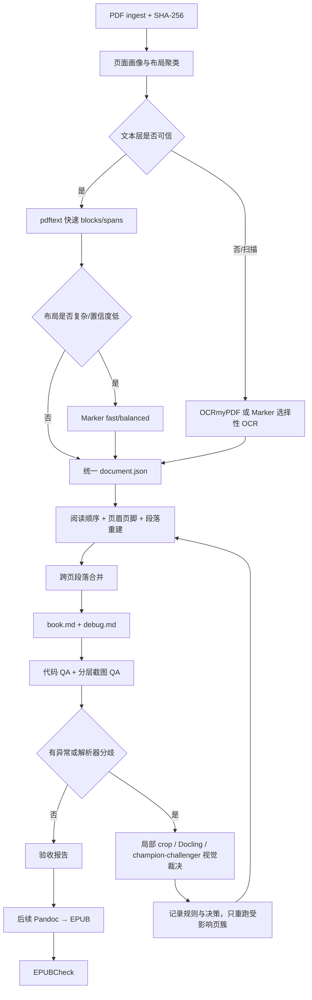

# 动态 PDF → Markdown 抽取自动化：调研、样本实测与实施计划

调研与实测日期：2026-07-21

## 1. 目标与边界

目标是面对每次都会变化的 PDF，在不依赖固定模板的前提下：

- 还原正确的阅读顺序、单词/文字间隔、段落、标题、列表、表格和图片引用。
- 跨页合并被分页切断的同一段落，同时保留可追溯的原页码与坐标。
- 移除真正的页眉、页脚和页码，但将“误删正文”视为最高优先级缺陷。
- 先输出简洁、稳定的 Markdown；以后从同一中间结构生成 EPUB、DOCX 等。
- 通过分层截图和结构化视觉审查迭代校准；只把异常页/区域送入昂贵路径。
- 能用 PDF 对象、字体、颜色、坐标、矢量线和统计规则确定的问题一律代码优先；模型只处理规则不确定性。
- 每本新 PDF 先生成一个有页数、字数、图片和视觉调用预算的连贯 pilot slice，人工审订通过后才扩展到全书。
- 项目定位为“帮助 AI agent 生成和校准 PDF 解析器的元工具”，明确分离可复用引擎与一次性文档适配。
- Python 统一由 `uv` 管理和锁定，保证实验与生产可复现。

不承诺对任意 PDF 都无条件全自动成功。系统必须输出置信度、决策日志和待复核项，低置信度时宁可保留可疑分页/页眉，也不静默删除正文。

## 2. 结论先行

建议采用“路由器 + 多层解析 + 统一中间表示 + 局部视觉校准”，而不是押注单一 PDF 库：

1. `pdftext` 做 born-digital PDF 的快速文本层与 bbox 首通道。
2. Marker 做复杂布局的主要结构解析器；优先 `fast/no-OCR`，有需要才升级 balanced/选择性 OCR。
3. Docling 只在低置信度、复杂表格或解析器不一致时做影子解析/回退。
4. OCRmyPDF 仅处理纯扫描、旋转、倾斜或坏 OCR 层，不对正常文本 PDF 整本重做 OCR。
5. `pdfplumber` 用于诊断、坐标核验、测试金标准辅助和可视化调试，不作为生产首通道。
6. 视觉模型不负责整本重抄；它负责判断阅读顺序、段落边界、页眉页脚、图表区域等疑难点，并返回结构化 issue/decision。
7. 视觉提供商采用 champion/challenger：基准集多模型同台，生产默认单模型首审，只有分歧或高风险项才升级第二/第三模型。
8. 每本书先跑“目录 + 第一章”或覆盖等价物的 pilot slice；人工确认后才允许全书处理。

Markdown 是派生的阅读产物；真正的“无损工作底稿”应为 `document.json`。否则一旦 Markdown 已经把页码、bbox、原始 block、置信度丢掉，后续很难可靠地反查和修复。

## 3. GitHub 调研结果

| 项目 | 可借鉴能力 | 定位 | 主要注意点 |
|---|---|---|---|
| [datalab-to/pdftext](https://github.com/datalab-to/pdftext) | 基于 PDFium 输出 page/block/line/span、字体和 bbox；Apache-2.0 | 快速原生文本层首通道 | 不负责完整语义结构、跨页段落与视觉闭环 |
| [datalab-to/marker](https://github.com/datalab-to/marker) | Markdown/JSON、版面/阅读顺序、表格/公式/图片、默认去页眉页脚、debug 页面图与 bbox、可选 LLM | 主要复杂布局解析器 | 模式和硬件差异大；项目自己的 benchmark 只能作为参考，必须用本地样本复测 |
| [docling-project/docling](https://github.com/docling-project/docling) | 高级版面、阅读顺序、表格、OCR、统一 DoclingDocument、Markdown 与 lossless JSON；MIT | 影子解析器/回退 | 依赖和模型较重；不必每页双跑 |
| [jsvine/pdfplumber](https://github.com/jsvine/pdfplumber) | char/word bbox、字体属性、裁切、文本/表格调试 | 诊断与测试工具 | 本地样本速度明显慢于 `pdftext`，且其 line API 部分仍是 experimental |
| [pymupdf/pymupdf4llm](https://github.com/pymupdf/pymupdf4llm) | Markdown/JSON、阅读顺序、表格、选择性 OCR、页级 chunk | 技术对照候选 | AGPL-3.0；闭源/商业使用前必须做许可决策，因此不设为默认依赖 |
| [ocrmypdf/OCRmyPDF](https://github.com/ocrmypdf/OCRmyPDF) | 扫描 PDF 加可搜索文本层、旋转/去倾斜、多语言 OCR | 扫描件预处理 | 需要 Tesseract 等系统依赖；它产生 OCR 层，不替代段落/阅读顺序重建 |
| [Layout-Parser/layout-parser](https://github.com/Layout-Parser/layout-parser) | 版面检测、区域裁切、bbox 可视化 | 可借鉴区域抽取 API | 当前不作为主骨架；维护/发布节奏和 Detectron2 依赖不如前述方案合适 |
| [Unstructured-IO/unstructured](https://github.com/Unstructured-IO/unstructured) | 文档分区、ETL、fast/hi-res/OCR 路由思想 | 架构参考 | 对本任务而言抽象层较高，定制跨页段落和截图闭环不如直接控制底层结构 |

Marker 明确支持默认移除 running header/footer，并在 debug 模式保存带检测结果的页面图与 JSON；Docling 提供统一文档结构和 lossless JSON。这两点与本任务高度吻合，但不能直接替代我们自己的跨页合并、置信度和迭代控制器。

## 4. 当前样本的实际测试

样本：`puzzle/Breaking Comedy's DNA_v1.4.4-[US]Jerry Corley.pdf`

### 4.1 文档基线

- 221 页，Letter 612 × 792 pt，约 3.44 MB。
- 221/221 页都有原生文本层；当前样本不应默认 OCR。
- `pdfplumber` 探测：275,932 个字符、48,499 个词；非空页中位数约 1,291 字符/226 词。
- 55 页含嵌入图片。
- 多个正文页从页面很靠上的位置直接续写。固定裁掉顶部 10%–15% 会误删正文。

### 4.2 本机抽取速度

两次测试均通过 `uv run --with ...` 运行，首次安装下载不计入脚本报告的抽取时间。

| 路径 | 工作内容 | 时间 | 吞吐 |
|---|---:|---:|---:|
| `pdftext.dictionary_output(sort=True)` | 221 页，1,673 blocks，276,989 span chars | 6.586 s | 33.56 页/s |
| `pdfplumber.extract_text(...)` | 221 页，273,402 chars | 23.390 s | 9.45 页/s |

在此样本和机器上，`pdftext` 吞吐约为 `pdfplumber` 的 3.55 倍，而且直接给出 block/line/span。这支持将它设为快速首通道。该数字不是跨机器或跨 PDF 的普遍结论，后续基准集需持续复测。

### 4.3 跨页段落实例

页面 37 末尾：

> that drives you crazy, and make it funny!” If you think something’s

页面 38 开头：

> weird or ridiculous or stupid or crazy or misplaced or ironic, that’s kind

这是明确的同段跨页续写，应合并为一个段落，并记录来源页 `37–38`。

只用“上一页不以终止标点结尾 + 下一页小写开头”扫描全书，得到 29 个候选；其中目录页 3→4 是已确认的误报。这说明标点规则适合生成候选，但自动合并还必须加入 block 类型、目录/章节状态、字体、缩进、列位置和视觉间距等特征。

### 4.4 截图分辨率、可读性与 token 代理成本

在正文密集的第 38 页上渲染 72–300 DPI，并以原生文本为参考跑本地 RapidOCR。OpenAI 当前图像文档说明：`low` 会收到 512×512 低分辨率图；GPT-5.6 的 `original/auto` 保留输入尺寸，patch 型图像成本按 32×32 patch 计算。详见 [OpenAI Images and vision](https://developers.openai.com/api/docs/guides/images-vision)。

下表的 “patch units” 是按官方公式从像素尺寸计算的 GPT-5.6 `original/auto` 图像成本代理；最终计费以具体模型/API 返回的 usage 为准。

| DPI | 像素 | patch units | 相对 96 DPI | RapidOCR 词 F1 |
|---:|---:|---:|---:|---:|
| 72 | 612×792 | 500 | 0.58× | 0.994 |
| 96 | 816×1056 | 858 | 1.00× | 0.921 |
| 120 | 1020×1320 | 1,344 | 1.57× | 0.873 |
| 144 | 1224×1584 | 1,950 | 2.27× | 0.942 |
| 168 | 1428×1848 | 2,610 | 3.04× | 0.804 |
| 180 | 1530×1980 | 2,976 | 3.47× | 0.844 |
| 216 | 1836×2376 | 4,350 | 5.07× | 0.915 |
| 300 | 2550×3300 | 8,320 | 9.70× | 0.828 |

观察：

- OCR 分数并不随 DPI 单调上升，原因包括检测器自己的缩放和行合并策略。因此不能用“更高 DPI 一定更准”作为策略。
- 72 DPI 在这张干净正文页上已可读且本地 OCR 最好，但人工/视觉模型查看时字号偏小。
- 96 DPI 已人工检查目录密集页、图文混排页、稀疏标题页和长文本页，均清楚可读；相对 120 DPI 节省约 36% patch，相对 144 DPI 节省约 56%。
- 300 DPI 成本约为 96 DPI 的 9.7 倍，在该 OCR 代理测试上反而更差，不应作为整页默认值。

因此建议：

- 72 DPI：只做版面概览、空白/栏数/图片区域判断。
- 96 DPI：默认整页文字 QA，显式使用 `detail="original"`，由我们先控制输入尺寸。
- 144 DPI：最小字体、密集目录、脚注或 96 DPI 低置信度时升级。
- 180–216 DPI：只对表格单元格、公式、脚注等局部 crop 升级，不发整页。
- 300 DPI：只保留给本地 OCR 的特殊案例；视觉 API 整页默认禁用。

RapidOCR 只是可读性代理。正式实现必须把每次视觉 API 的实际 `input_tokens`、模型、detail、宽高和 crop 面积写入 usage 日志，才能得到真实成本曲线。

### 4.5 Gemini 与多视觉模型的当前价格比较

结论：Gemini 可以显著更便宜，但不能把“Gemini”当成一个价格档位。

- [Gemini 3.1 Flash-Lite](https://ai.google.dev/gemini-api/docs/models/gemini-3.1-flash-lite) 是适合高频轻量结构判断的当前稳定低价模型，官方价格为输入 `$0.25/MTok`、输出 `$1.50/MTok`。
- [Gemini 2.5 Flash-Lite](https://ai.google.dev/gemini-api/docs/models/gemini-2.5-flash-lite) 更便宜，输入 `$0.10/MTok`、输出 `$0.40/MTok`，适合纳入廉价筛查基准，但是否能可靠识别小字、跨栏和细粒度格式必须由 gold set 决定。
- Gemini 3.5 Flash 为输入 `$1.50/MTok`、输出 `$9/MTok`；它不一定比 OpenAI GPT-5.6 Luna 便宜。
- OpenAI 当前 GPT-5.6 Luna 为输入 `$1/MTok`、输出 `$6/MTok`，Terra 为 `$2.50/$15`。详见 [OpenAI models](https://developers.openai.com/api/docs/models)。
- Claude Haiku 4.5 为输入 `$1/MTok`、输出 `$5/MTok`，图像以 28×28 patch 计量；详见 [Claude models](https://platform.claude.com/docs/en/about-claude/models/overview) 与 [Claude vision](https://platform.claude.com/docs/en/build-with-claude/vision)。

Gemini 3 可用 `media_resolution` 控制每张图片/PDF 页的视觉预算：image/PDF 的 low、medium、high 大致对应 280、560、1120 tokens，Google 对标准 PDF 理解推荐 medium，并指出标准文档从 medium 提升到 high 往往不再改善 OCR。详见 [Gemini media resolution](https://ai.google.dev/gemini-api/docs/media-resolution) 与 [Gemini pricing](https://ai.google.dev/gemini-api/docs/pricing)。

以本次 96 DPI 页面、返回 200 个 JSON 文本 token 为例，忽略 prompt 文本、缓存、推理 token、重试和折扣后的粗略标准价：

| 模型/设置 | 估算图像输入 token | 图像输入约价 | 200 输出 token 约价 | 合计约价/页 |
|---|---:|---:|---:|---:|
| Gemini 2.5 Flash-Lite medium | 256 | $0.000026 | $0.000080 | $0.000106 |
| Gemini 3.1 Flash-Lite medium | 560 | $0.000140 | $0.000300 | $0.000440 |
| OpenAI GPT-5.6 Luna original | 858 | $0.000858 | $0.001200 | $0.002058 |
| Claude Haiku 4.5 | 1,140 | $0.001140 | $0.001000 | $0.002140 |
| Gemini 3.5 Flash medium | 560 | $0.000840 | $0.001800 | $0.002640 |
| OpenAI GPT-5.6 Terra original | 858 | $0.002145 | $0.003000 | $0.005145 |

这只是定价模型推算，不是质量排名。正式选择必须测 `issue precision/recall × cost × latency`；并把输出限制为短 JSON，因为对视觉 QA 来说，输出 token 往往比图像输入更贵。

## 5. 自动化架构



### 5.1 页面画像与动态路由

每页先计算，不调用视觉模型：

- 文本字符数、不可打印/替换字符率、字体数量与最小字号。
- 页面尺寸/旋转、图片区占比、矢量图密度、文本 bbox 覆盖率。
- 行宽分布、x 起点聚类、疑似列数、阅读顺序跳变。
- OCR 层重复、隐藏文字、同坐标重复字符。
- 与相邻页的布局签名相似度。

按布局签名将页面聚成若干 section/layout clusters。页眉页脚和段落参数在页簇内学习，而不是拿整本书的一套固定阈值硬套。

### 5.2 统一中间表示

建议输出：

```text
artifacts/<run-id>/
  document.json          # 无损、带 bbox/样式/来源/置信度
  book.md                # 干净阅读版 Markdown
  book.debug.md          # 可选，带隐藏 provenance/issue 标记
  assets/                # 抽取图片
  qa/manifest.jsonl      # 截图、crop、DPI、patch/token、问题和裁决
  qa/screenshots/
  report.json            # 指标、失败项、版本与耗时
```

`document.json` 的 block 至少包含：

- `id`, `type`, `text`, `page`, `bbox_norm`, `reading_order`
- `font_family`, `font_size`, `weight`, `italic`, `underline`, `fill_rgb`, `stroke_rgb`, `style_runs`
- `source_parser`, `source_block_id`, `confidence`
- `removed_as`, `merge_from`, `merge_reasons`, `decision_version`

可读版 `book.md` 不放可见页码，不用复杂 CSS。来源信息保留在 JSON；debug 版可用 HTML comment 表示 `src:p37-p38`，避免污染 EPUB。

### 5.3 分词与文字规范化

将两个概念分开：

1. **视觉词/空格重建**：由字符/word bbox、字体和间距完成，直接决定 Markdown 可读文本。
2. **NLP 分词**：仅用于检索、相似度、语言判断和 QA，写入旁车索引，不能反向往中文正文中硬插空格。

规范化顺序：Unicode NFKC（保留有语义的原字形例外）→ ligature 展开 → 重复字符去重 → 行内空格判定 → 跨行断词/连字符判定 → 段落重建。原始文本和每个变换步骤都要可追溯。

### 5.4 代码优先的章节与行内格式识别

模型调用前先从 PDF 原生对象计算候选和置信度：

- **目录**：点线 leader、右对齐页码、重复缩进层级、短行密度、内部链接/书签目标、连续页码范围。
- **标题/章标题**：字号相对正文众数的 z-score、粗体/颜色、页面位置、上下留白、短行、编号模式、书签/outline，以及标题后正文的稳定转场。
- **正文**：页簇内的主字体/字号/行高、稳定左右边界、正常句法长度和连续段落流。
- **页眉页脚**：页簇内跨页重复、稳定 y 坐标、奇偶页模式和页码序列；禁止只按固定裁边删除。
- **加粗**：字体 weight/name/flags；同时检测“同坐标或轻微偏移重复绘制”造成的模拟粗体并先去重。
- **斜体**：italic font/flags、字体名和必要时 glyph transform/shear。
- **下划线**：不能只看字体；匹配文字 baseline 下方、x 范围重叠的细水平 line/rect，区分表格线、删除线和链接装饰。
- **标红/颜色**：读取文字 fill/stroke RGB；进行颜色聚类和对比度阈值判断，不能依赖截图像素猜色。

标准 Markdown 映射：粗体 `**text**`、斜体 `*text*`。下划线和有语义的颜色使用最小内嵌 HTML，例如 `<u>`、`<span class="text-red">`；具体 RGB 和来源 span 保留在 `document.json`。装饰性色彩默认不进入阅读版，语义性色彩才保留。

代码规则输出 `type/style + confidence + evidence`。只有多特征冲突、字体元数据损坏、视觉模拟格式或解析器分歧时才进入视觉队列。

### 5.5 页眉、页脚和页码

候选特征：

- 位于页簇顶部/底部带区，但“在带区”本身不能触发删除。
- 规范化数字后，文本在同一页簇中重复；允许奇偶页交替标题。
- y 位置和字体稳定，正文重叠率低。
- 页码符合单调序列、罗马数字或“Page x of y”等模式。
- 封面、目录、章首页单独处理，不参与常规重复统计。

删除策略：需要至少两个独立证据，并保留 tombstone 记录。低置信度只在 `book.debug.md` 标注，不自动删除。验收指标优先优化 precision，目标是正文误删为 0。

### 5.6 段落与跨页合并

页内合并使用：行距相对中位数、首行/悬挂缩进、左右边界、字体样式、项目符号、列归属、标点和语义连续性。

跨页只在下列条件组合满足时合并：

- 上一页末 block 与下一页首 block 都是 paragraph，不跨章节/列表/表格/图片边界。
- 两者列位置、字体、字号、行宽和缩进兼容。
- 上一页末句无终止标点或以软连字符结尾；下一页以小写/续写标点开头是加分项，不是单独决定项。
- 下一页首 block 不是 running header、标题、目录条目或 caption。
- 合并后语言模型/规则连贯性提高，且不引入异常空格。

高置信度自动合并；中置信度保留分页并进入局部截图队列；低置信度不合并。精度优先于召回，因为错误合并比暂时多一个段落边界更难发现。

## 6. 截图驱动的动态调试闭环

截图闭环在代码 QA 之后运行。目录、标题、正文、页眉、页脚和行内样式若已由 PDF 对象高置信度确定，不再调用视觉模型。

### 6.1 首轮抽样

不截全书。按布局簇分层抽取：封面、目录、章首页、最密/最稀页面、最小字号页、多栏页、图片/表格页、旋转页、首尾页，以及每个异常分数分位点。常规 200 页书初始约 8–16 页。

### 6.2 两类截图

- 原始页：确认肉眼阅读顺序和真实段落。
- debug overlay：在图上叠加 block 类型、reading-order 编号、删除候选、merge 边界和置信度。

视觉模型只返回 JSON issue：`page`, `bbox`, `issue_type`, `expected_order`, `severity`, `confidence`, `evidence`。禁止它直接重写整本 Markdown。

### 6.3 升级条件

- 72 DPI 版面概览发现密集小字 → 整页 96 DPI。
- 96 DPI 最小字不可读/表格单元格混淆 → 只裁相关 bbox，144–216 DPI。
- 两个解析器 reading order 不一致 → 同一 crop 视觉裁决。
- 页眉页脚删除置信度不足 → 发相邻 4–6 页的低分辨率 contact sheet，而不是逐页高分辨率。

### 6.4 停止条件

- 金标准指标达到门槛且无 severity 1/2 issue。
- 连续一轮没有新增高价值修正。
- 单页最多 3 次升级；仍不确定则进入人工复核清单，禁止无限 token 循环。

### 6.5 多模型 champion/challenger

不在生产中默认让三家模型逐页投票。采用三层策略：

1. **离线基准**：Gemini 2.5/3.1 Flash-Lite、Gemini 3.5 Flash、OpenAI Luna/Terra、Claude Haiku，以及可用的本地 VLM，在同一截图、同一 JSON schema 和同一 gold set 上全量对比。
2. **生产首审**：选择单位正确 issue 成本最低的 champion；初始优先测试 Gemini 3.1 Flash-Lite medium，Gemini 2.5 Flash-Lite 作为更廉价 challenger。
3. **升级/裁决**：低置信、严重 issue、解析器冲突或抽样审计才调用第二模型；两者不一致时才调用更强模型或人工。

生产运行保留 5%–10% shadow sample 给 challenger，按稳定模型 ID 锁定版本。模型价格、质量或版本变化后重跑基准，不把供应商名字硬编码进核心算法。

## 7. 实施与实际测试计划

### Phase 0：`uv` 项目与可复现基线

工作：

- `uv init --package`，创建 `pyproject.toml` 和 `uv.lock`。
- core/marker/docling/qa 分 optional dependency groups，避免默认安装全部大模型。
- 记录 Python、Poppler、解析器、模型、prompt 和规则版本。

验收：全新机器 `uv sync --locked` 后可复现同一命令；相同输入得到相同 artifact hash（时间戳字段除外）。

### Phase 1：建立动态基准集和人工金标准

工作：

- 当前 PDF 选 20 页：目录、章首页、图文混排、密集正文、最小字、跨页、尾页。
- 对 220 个页间边界至少标 40 个高风险边界，并覆盖 29 个简单规则候选。
- 新 PDF 到来时自动追加新布局簇的 2–3 页，不要求整本人工标注。
- 标注 block 类型、阅读顺序、段落边界、跨页 merge、页眉页脚和图片 caption。

验收：双人/二次复核的不一致项归零；gold 数据保留来源截图和 bbox。

### Phase 2：候选解析器同台基准

工作：

- `pdftext`、Marker fast/no-OCR、Marker balanced、Docling 在同一页集运行。
- 比较文本 CER、block/段落 F1、reading-order edge accuracy、表格结构、CPU/GPU 秒/页、内存和产物大小。
- born-digital 与 scanned/mixed 分开报告，不做混合平均掩盖问题。

选择门槛：默认路径应在当前样本达到 paragraph boundary F1 ≥ 0.97、reading order ≥ 0.98；复杂/扫描集单列门槛 ≥ 0.92。最终以自有 gold 为准，不以项目 README benchmark 代替。

### Phase 3：清洗、页眉页脚与页内段落

工作：

- 实现 section-aware 重复检测、奇偶页 header、页码序列和 tombstone。
- 实现字符去重、空格、连字符、缩进和列表处理。
- 为所有删除与合并输出 explainable reason codes。

验收：gold 上正文误删 0；页眉页脚 precision 1.00、recall ≥ 0.95；段落边界 F1 达到 Phase 2 门槛。

### Phase 4：跨页段落合并

工作：

- 先用硬规则过滤，再用可解释特征打分；只把中置信候选送入局部视觉/小模型裁决。
- 专门测试目录、列表、引文、对话、脚注、表格跨页和章切换。
- 保存 `merge_from` 与反向拆分能力。

验收：跨页 merge precision ≥ 0.99、recall ≥ 0.95；当前 37→38 必须合并，目录 3→4 必须拒绝。

### Phase 5：截图 QA 与成本校准

工作：

- 复用当前 72/96/144/300 DPI 证据，另在新 PDF 每个布局簇抽样。
- 使用 72→96→局部 144/216 的升级策略，与固定 144、固定 300 做 A/B。
- 同一 gold set 对比 Gemini Flash-Lite/Flash、OpenAI Luna/Terra、Claude Haiku 和可选本地 VLM；测正确 issue 成本，而非只测单价。
- 生产实现 champion/challenger，禁止默认逐页多模型投票。
- 记录实际 API usage，而非只记录 PNG 大小或理论 patch。
- 视觉 prompt 固定为 issue detection + structured output，并做回归测试。

初始成本门槛：常规整页 QA 平均 ≤ 900 patch units/被抽样页，p95 ≤ 1,950；整本被视觉检查页比例默认 ≤ 10%，异常驱动可突破但必须报告原因。

### Phase 6：Markdown 产物与回归

工作：

- 输出 YAML front matter、标题、正文、列表、表格、图片和脚注；样式从简。
- 生成普通版和 debug 版；普通版不暴露页码/bbox。
- snapshot + semantic tests，避免只比较整文件字符串。

验收：Markdown lint 通过；图片链接完整；无孤立软连字符、重复页眉页脚、异常超长段或空标题；所有文本可映射回 `document.json`。

### Phase 6.5：每本新 PDF 的 pilot slice 人工门禁

Phase 6 完成后，每本新 PDF 都先完整跑一个“可阅读且能暴露问题”的小切片，不直接处理全书。

默认选择：

- front matter/目录（若存在）；
- 第一章从章标题到下一章标题；
- 该范围外每种新布局簇或高异常类型各 1 页，放入单独 diagnostic appendix，不打乱连续阅读稿。

预算由配置控制，并在任一 hard cap 到达时停止：

- `pilot.max_pages`：默认 30；
- `pilot.max_words`：默认 15,000；
- `pilot.max_images`：默认 40；
- `pilot.max_vision_pages`：默认 12；
- `pilot.max_api_cost_usd`：必须显式配置；
- `pilot.min_body_pages`：默认 8，避免样本过小。

没有目录或章节时，使用结构/主题变化点估计首个连贯 section；仍无法分章则取前 8–20 个正文页，再加 coverage-driven diagnostic pages。页数与字数上限都存在，避免“无章节书籍”一直读到全书。

pilot 输出 `pilot/book.md`、`pilot/document.json`、`pilot/issues.md` 和截图包，先供人工审订。人工修改必须结构化为 accept/reject/correct decision；只有 pilot 通过且新增规则拥有回归测试，才开启 full-book run。

### Phase 7：EPUB（Markdown 稳定后）

工作：

- 用 [Pandoc](https://pandoc.org/demos.html) 从 Markdown 生成 EPUB，提供最小 CSS、封面、语言、作者和目录 metadata。
- 用 [W3C EPUBCheck](https://github.com/w3c/epubcheck) 做规范验证。
- 对至少两种阅读器做章节导航、图片缩放、脚注、表格和字体回流测试。

验收：EPUBCheck 0 error；目录/章节顺序正确；无固定页码残留；窄屏回流正常。

## 8. 元工具定位与可复用层次

本项目不是一个固定 PDF 转换器，而是帮助 AI agent 为每种新 PDF 生成、检验和收敛解析策略的元工具。分三层：

1. **永久可复用 core**：统一 schema、解析器 adapters、bbox/颜色/字体规则、段落算法、渲染、预算器、模型路由、评估指标和 artifact 协议。
2. **可晋升 knowledge**：跨多本 PDF 复现并有 regression test 的规则、布局分类器和 prompt；只有经过证据支持才进入 core/knowledge。
3. **一次性 run profile**：某本 PDF 的页簇、异常、阈值覆盖、临时 prompt、人工裁决和预算。默认随文档保存，不污染全局规则。

建议结构：

```text
src/pdfcracker/          # reusable engine
tests/golden/            # cross-document regression set
knowledge/rules/         # promoted reusable rules with provenance
runs/<document-id>/
  profile.yaml           # per-document adaptive settings
  decisions.jsonl        # agent/human decisions
  pilot/                 # coherent review slice
  full/                  # only after pilot approval
AGENTS.md                 # concise durable agent behavior
```

规则晋升流程：先写进 run profile → 在另一 PDF 重现或证明是格式规范 → 添加 regression test → 晋升 knowledge/core。文档专有页码、标题、阈值和临时 workaround 永不写进 `AGENTS.md`。

`AGENTS.md` 动态维护遵循 Codex 官方建议的“重复摩擦后再沉淀”：同类 agent 错误至少出现两次，或出现新的普遍不变量时，先做 retrospective，再更新简短英文规则、相关测试和计划。它保存稳定原则与验证命令，不保存某本书的版式事实。

## 9. 回归指标面板

每次运行至少报告：

- `text_cer`, `word_f1`
- `paragraph_boundary_precision/recall/f1`
- `cross_page_merge_precision/recall/f1`
- `header_footer_precision/recall` 和 `body_deleted_count`
- `reading_order_edge_accuracy`
- `manual_review_pages`, `vision_pages`, `vision_crops`
- `cpu_seconds_per_page`, `gpu_seconds_per_page`, peak RAM/VRAM
- `image_patch_estimate`, 实际 API `input_tokens/output_tokens`, 重试次数
- 解析器分歧数量、未解决 severity issue 数量

上线阻断条件：正文误删 > 0、跨页误合并、严重 reading-order 错误、未解决 severity 1 issue、EPUBCheck error。

## 10. 建议的首个实现切片

第一切片不要立即接视觉 API，也不要先装全部重模型。顺序应是：

1. `uv` 初始化与 `document.json` schema。
2. `pdftext` 快速抽取当前样本。
3. 页内段落、页眉页脚候选与 37→38 / 3→4 两个跨页回归测试。
4. 输出 `book.md`、debug overlay 和 QA manifest。
5. 再接 Marker，并只在复杂页簇比较增益。
6. 最后接视觉裁决和 Docling fallback；用实际 usage 校准 96 DPI 默认档。
7. 启用 Phase 6.5 pilot gate；人工确认第一章后才启动全书。

这样第一周就能得到可阅读、可追溯、可测量的 Markdown，而不会让 GPU/OCR/视觉调用把核心段落逻辑掩盖掉。

## 12. 首次实现与在线实验进展（2026-07-21）

- 已完成 `uv` package 初始化，固定 Python 3.12，生成 `uv.lock`；默认 core 与可选 `diagnostics` extra 分离。
- 已实现 `extract`、`render`、`vision-benchmark`、`style-probe` 四个 CLI。
- 当前回归测试覆盖目录拒绝跨页合并、37→38 正确合并、页 38 紧邻 block 重组、页码范围和视觉 gold 计分。
- pilot 已生成在 `runs/breaking-comedys-dna/pilot/`：PDF 3-20 为连贯审订范围，37-38 为跨页诊断页。
- 两页、三分辨率、三模型的在线视觉实验记录见 `runs/breaking-comedys-dna/pilot/qa/EXPERIMENT.md`。初始 champion 为 Gemini 3.1 Flash-Lite 96 DPI；细线样式升级 144 DPI；GPT-5.4 Mini 仅作分歧 challenger。
- 代码原生样式探针已证明可直接提取红/蓝文字、斜体字体和下划线矢量证据，下一步是将其融合进 `document.json`，而不是扩大视觉调用。
- full-book gate 仍关闭；图片导出、样式融合、TOC 层级与本轮人工审订通过前不得处理全书。

### 人工审订第 1 轮后的修正

- `document.json` 的 span 已使用正交字段保存 bold、italic、underline、semantic color、exact RGB 与 evidence；复杂嵌套不再扁平化。
- `pypdf` 内容流的 text rendering mode 可识别字体元数据无法识别的 synthetic bold；`pdfplumber` 提供字体、颜色、下划线/框线几何。
- TOC 由行级 x 缩进恢复为响应式三级列表，阅读版移除 leader dots 和印刷页码，原值保留在 JSON。
- 框选 callout 与缩进短引语映射为 blockquote；第 38 页四条提示语保持四段。
- 混合字号 block 在分类前拆分，`What Makes Something Comedy?` 已成为独立 H2。
- 已增加“样式不能因 PDF 绘制分片而在单词中间断开”的通用规则；颜色不做该扩展，以保留彩色首字母。
- 13 个回归测试覆盖上述修正与粗斜体/下划线/颜色嵌套。当前 full-book blocker 收敛为图片导出、TOC 链接映射和修正版 pilot 二次审订。

## 11. 已保存的测试证据

- `research/benchmarks/sample_probe.json`：221 页探测结果、页面统计和候选边界。
- `research/benchmarks/dpi_benchmark.json`：第 38 页多 DPI/OCR/patch 基准。
- `research/scripts/probe_sample.py`：样本探测脚本。
- `research/scripts/benchmark_dpi.py`：分辨率基准脚本。
- `research/scripts/estimate_vision_costs.py` 与 `research/benchmarks/vision_cost_estimates.json`：按官方价格和 token 规则生成的多模型成本估算。
- `research/evidence/`：72/96/144/300 DPI 以及多类 96 DPI 页面截图。

这些脚本目前是研究证据。正式实现时迁入 `src/`/`tests/`，由 `uv` 锁定依赖，并将参数、日志和错误处理产品化。
